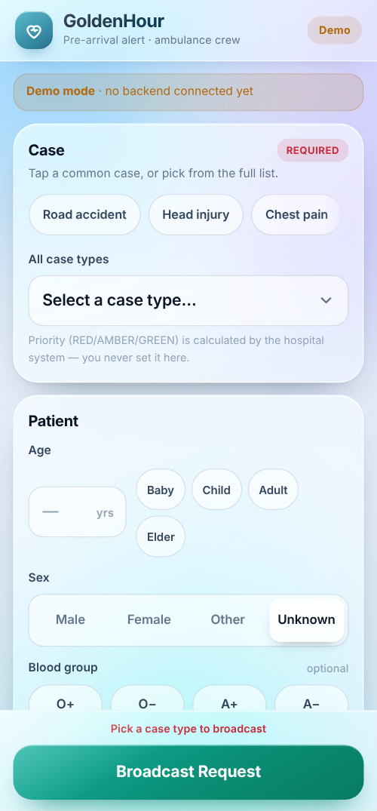
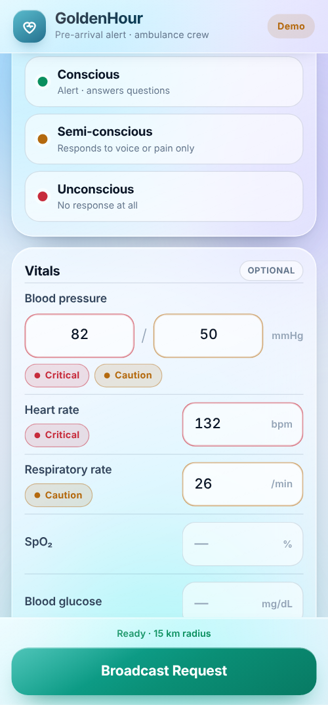
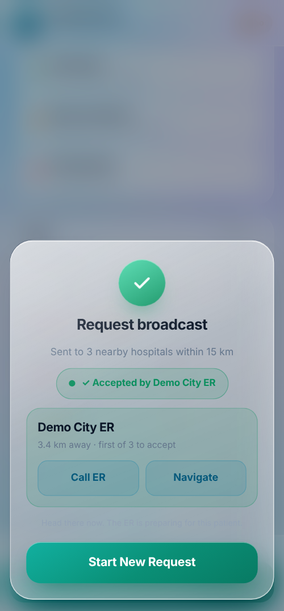

# GoldenHour — Ambulance App

**Pre-arrival alerts from the ambulance to every nearby hospital, in one tap.**
Built for Smart India Hackathon (SIH) 2026.

The paramedic fills in a short case form and taps **Broadcast Request**. Every
registered hospital inside the chosen radius is alerted at once. The first
hospital to accept claims the case, and the ambulance screen updates itself to
**"✓ Accepted by …"** with call and navigate buttons.

Plain HTML, CSS and JavaScript: no framework, no bundler, no build step.
[Capacitor](https://capacitorjs.com/) wraps the web app into an Android APK.

<p align="center">
  
  &nbsp;
  
  &nbsp;
  
</p>

<sub>Screenshots taken from the built-in demo mode (no backend connected).</sub>

---

## Contents

- [Why](#why)
- [Features](#features)
- [Tech stack](#tech-stack)
- [How it works](#how-it-works)
- [Getting started](#getting-started)
- [Build the APK](#build-the-apk)
- [Connecting a backend](#connecting-a-backend)
- [Project structure](#project-structure)
- [Testing](#testing)
- [Limitations](#limitations)
- [Related repositories](#related-repositories)

## Why

In an emergency, the receiving hospital usually learns about the patient only
when the ambulance arrives. GoldenHour sends the essentials (case type, vitals,
consciousness, location, ETA and photos) *before* arrival, so the ER can get
ready during the "golden hour" that follows a serious injury or medical event.

## Features

- **One-tap case selection.** Quick chips for common cases, plus a grouped
  list of every case type (trauma, cardiac, stroke, obstetric and more).
- **Vitals with bedside colour bands.** Blood pressure, heart rate,
  respiratory rate, SpO₂ and glucose show *Critical* or *Caution* labels, as
  text as well as colour. Implausible values get a "Check value" chip but never
  block the broadcast.
- **FAST stroke assessment.** The Face, Arm and Speech panel and the onset time
  appear only when a stroke case is chosen.
- **Location-based broadcast.** The device's GPS fix plus an adjustable
  radius (2–40 km) decide which hospitals are alerted. The crew never picks a
  hospital.
- **Scene photos.** Up to four photos, compressed on the device before upload.
- **Live acceptance status.** The app polls the case until a hospital accepts,
  then shows the hospital card with **Call ER** and **Navigate**.
- **Fails loudly, retries safely.** Network errors open an error dialog with
  *Retry*. A failed case-type fetch falls back to a built-in list.
- **Demo mode.** It works with no backend: sample cases, a fixed Bengaluru
  location and a simulated hospital acceptance.
- **Mobile-first accessibility.** Controls are at least 44 px tall, every input
  is labelled, overlays are real dialogs, and there are reduced-motion and dark
  themes. No web fonts are fetched, so the APK works offline.

## Tech stack

| Layer | Technology |
|---|---|
| UI | HTML5, CSS3 ("liquid-glass" design system), vanilla JavaScript (ES5-compatible) |
| Native shell | Capacitor 8 (Android), `@capacitor/camera`, `@capacitor/geolocation` |
| Android build | Gradle, JDK 21, Android SDK 36 |
| Tests | Node.js, jsdom |
| CI | GitHub Actions: runs the tests, then builds a debug APK |

## How it works

```text
 Ambulance app ──GET /case-types──────────▶ Backend
      │
      ├──POST /requests (case + vitals + GPS + radius)──▶ Backend
      │                                    ├─ finds hospitals within radius (Haversine)
      │                                    ├─ alerts all of them
      │                                    └─ first accept wins (one transaction)
      │
      └──GET /requests/{id}  (every 5 s) ──▶ PENDING → ACCEPTED / EXPIRED
```

The full backend contract (payloads, value ranges and the acceptance rules) is
in [`API.md`](API.md). The design rationale, screen flow and state machine are
in [`GoldenHour-Master-Doc-v3.md`](GoldenHour-Master-Doc-v3.md).

## Getting started

### Try it in five seconds

Open `www/index.html` in any browser. It starts in demo mode.

### Prerequisites for development

- Node.js 22 (jsdom 30 and Capacitor 8 need it)
- For a local APK build: JDK 21 and the Android SDK (platform 36)

```bash
git clone https://github.com/Gokuxhope/golden-hour-apk-.git
cd golden-hour-apk-
npm install
npm test
```

## Build the APK

### Option A: GitHub Actions (no Android Studio needed)

1. Open the **Actions** tab, choose **Build GoldenHour APK**, then **Run workflow**.
   It also runs on every push to `main`.
2. When the run is green, download the `goldenhour-debug-apk` artifact.
3. Unzip it, copy `app-debug.apk` to an Android phone and install it.
   Allow "Install unknown apps" once.

### Option B: build locally

```bash
npm install
npx cap sync android
cd android && ./gradlew assembleDebug
# Output: android/app/build/outputs/apk/debug/app-debug.apk
```

Edit files in `www/` only, then run `npx cap sync android`.
`android/app/src/main/assets/public/` is overwritten on every sync.

## Connecting a backend

Change one line at the top of `www/app.js`:

```js
var API_BASE = "https://your-backend.example.com/api";
```

While `API_BASE` still contains `REPLACE-WITH-YOUR-BACKEND`, the app stays in
demo mode and makes no network calls. No API keys or secrets are needed on the
client.

## Project structure

```text
www/                  the web app (the source of truth)
  index.html          every screen
  app.js              all application logic
  style.css           liquid-glass design system
tests/
  test.js             unit checks (payload rules, vital bands, ranges)
  functional.test.js  end-to-end UI checks in jsdom
android/              generated Capacitor project (manifest hand-edited)
capacitor.config.json
.github/workflows/    CI: tests, then the APK build
API.md                backend contract
docs/screenshots/     images used in this README
```

## Testing

```bash
npm test            # unit + functional
npm run test:unit
npm run test:functional
```

Last run (Node 22): **90 unit checks and 80 functional checks passed.**

## Limitations

- This is a hackathon prototype. It is **not clinically validated**: the
  colour bands are a bedside hint, not triage.
- Status updates use polling every 5 seconds, not push notifications.
- The CI builds a **debug** APK only; there is no signed release build yet.
- The app needs a backend that implements [`API.md`](API.md) to go beyond demo
  mode.

## Related repositories

- [skushal18/GoldenHour-SIH2026](https://github.com/skushal18/GoldenHour-SIH2026):
  the team's full system, with the backend, the hospital ER desk and the
  Bengaluru hospital dataset.
- [skushal18/GoldenHour-SIH2026-Patched](https://github.com/skushal18/GoldenHour-SIH2026-Patched):
  the later v6 rebuild, with central hospital sign-in, an all-India hospital
  directory and AWS hosting.

## Author

[Mihir Mishra (@Gokuxhope)](https://github.com/Gokuxhope), as part of the
GoldenHour SIH 2026 team.

`package.json` declares the MIT license, but there is no `LICENSE` file in the
repository yet.
